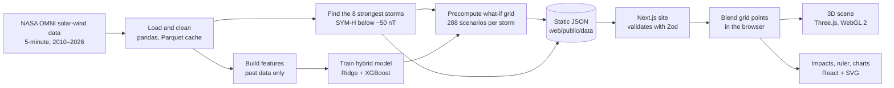

# Dial-a-Storm

> This project was built in 24 hours for Sheridan Datathon 2026. It was the **Winner, Best Visualization and Storytelling track (NASA track).**

Dial-a-Storm replays the eight strongest geomagnetic storms of 2010–2026 in an interactive 3D scene. You can then turn up the Sun and see what a stronger storm would have done to Earth.

**Live site:** [SunnyWithAChanceOfStorms.vodka](https://sunnywithachanceofstorms.vodka/)

**Demo video:** [Watch on YouTube](https://www.youtube.com/watch?v=juPEC7t1xSU)

## The problem

Every few years the Sun throws a billion-tonne cloud of magnetised plasma at Earth. If that cloud's magnetic field points south when it arrives, it links up with Earth's own field and pours energy into the space around the planet. That is a geomagnetic storm. It pushes the aurora toward the equator, makes GPS drift, drags satellites out of orbit and drives currents through power grids.

Scientists measure a storm with an index called SYM-H, in nanotesla (nT). The May 2024 Gannon storm, the strongest in twenty years, reached −497 nT. That number means nothing to most people. It doesn't tell you whether the lights stay on.

Gannon also wasn't close to the worst storm on record. The Carrington Event of September 1859 is estimated at somewhere between −850 and −1760 nT. People saw its aurora in Cuba and Hawaii, and telegraph wires sparked and shocked their operators. A storm like that has never hit a world that runs on satellites and long-distance power lines.

We wanted to answer two questions in a way anyone could see:

1. **What did these storms actually do?** Show the Sun, the solar wind, Earth's magnetic shield and the aurora in 3D, driven by real NASA measurements. Translate SYM-H into things people understand: how far south the aurora reached, and what happened to power grids, satellites, GPS and radio.
2. **What if one had been stronger?** Let people turn a dial that scales up the solar wind behind a real storm. A machine-learning model then predicts the result, placed on a ruler next to Gannon 2024, the Québec blackout of 1989 and Carrington.

> To maximize output during the 24-hour hackathon, we utilized agentic development workflows. We orchestrated Claude Code CLI, Kiro CLI, and custom agent instructions to rapidly scaffold and test the Next.js/WebGL frontend while the team focused on engineering the hybrid Ridge/XGBoost data pipeline and improving the UI.

## What you can do

- **Simulator tab.** Pick one of eight storms and press play. The 3D scene replays it: the solar wind speeds up, Earth's magnetic shield (the magnetopause) gets squashed, and a ring of current builds around Earth. The aurora also slides toward the equator. A panel on the right translates the live SYM-H into consequences, from "Polar skies only" to "Continental" blackouts. Each level names a real event where it actually happened.
- **The storm dial.** One knob scales the storm from ×0.5 to ×3. It mostly scales the southward magnetic field, which is what opens Earth's shield, and scales wind speed and density more gently. "Fine-tune" exposes all three separately. At ×3, the Gannon storm reaches about −857 nT, the low end of the Carrington estimates.
- **Explainer tab.** Walks through the chain from the solar eruption to the aurora, how the model works, how it did on a storm it never saw, and the limits of a what-if.
- **Honest flags.** If a scenario goes beyond anything in the training data, the UI says so with a "beyond training data" warning, and the warning is never hidden. The Explainer shows the model's miss on the held-out Gannon storm in plain numbers.

## How it works

The project has two halves that only talk through static JSON files. An offline Python pipeline trains the model and precomputes every what-if scenario. The website loads those files and runs everything else in the browser. No server runs Python, and the browser never calls a model.



### The model

The model predicts SYM-H from the solar wind measured upstream of Earth: magnetic field, speed and density. It never sees SYM-H or any other measurement of Earth's response as an input.

- **Physics backbone (Ridge regression).** A ring-current model from the space-physics literature (Burton, O'Brien and McPherron) turns the solar wind into an estimate of how much energy is stored around Earth. A Ridge regression maps that estimate to SYM-H. Because this part is linear, it keeps scaling when you push the dial past anything in the training data.
- **Correction (XGBoost).** A gradient-boosted tree model learns the patterns the backbone misses, using recent history of each driver. Trees alone can't predict anything beyond the largest value they were trained on, which is why they only correct the backbone and are never the whole model.
- **Strict testing.** Train on 2010–2019, tune on 2020–2022, test on 2023–2026. No feature at a given time can use data from later than that time, and 17 automated tests enforce this. The Gannon storm was never used for training, tuning or early stopping.

On the held-out Gannon storm, the hybrid predicts a peak of −272 nT, against −497 nT observed. The predicted peak comes 75 minutes late. That beats Ridge alone (−220 nT) and XGBoost alone (−160 nT), but it still underestimates the most extreme storm in the dataset. The site states this openly rather than hiding it. On the full 2023–2026 test set, the hybrid has an RMSE of 11.5 nT and an R² of 0.79.

### What-if scenarios

For each storm, the pipeline reruns the model on a grid of 8 × 6 × 6 = 288 scaled versions of the real solar wind. The grid scales southward field ×0.5 to ×3, speed ×0.8 to ×1.5, and density ×0.5 to ×3. The website blends the nearest grid points (trilinear interpolation) as you turn the dial. Turning the dial therefore updates the prediction instantly, at 60 frames per second, with no model running in the browser.

## Tech stack

| Technology | What it does here | Why we chose it |
|---|---|---|
| **NASA OMNI** | 5-minute solar-wind and geomagnetic data, 2010–2026, about 1.77 million rows. | The standard dataset for solar wind measured just upstream of Earth, with SYM-H included. |
| **Python, pandas, PyArrow** | Loads the CSV, fills short gaps using only past data, and caches it as Parquet. | pandas handles time series well. Parquet makes reloading the 138 MB CSV take seconds. |
| **scikit-learn (Ridge)** | Physics backbone of the model. | Simple, fast, and it extrapolates linearly, which a what-if tool needs. |
| **XGBoost** | Corrects the backbone's errors. | Strong on tabular data and quick to train (about 10 seconds here). |
| **pytest** | Tests that no feature can see the future and that response measurements never become inputs. | Data leakage is the easiest way to fake a good score, so we test for it on every run. |
| **Next.js 14 and React 18** | The website: the landing page, the two tabs and all the panels. | A modern React framework that builds to a fast static site. |
| **TypeScript** | Types across the whole front end. | Catches mistakes in the data-handling code before they reach the browser. |
| **Three.js, React Three Fiber** | The 3D scene: Sun, solar wind particles, magnetopause, field lines, ring current and aurora. | WebGL 2 runs in every modern browser. React Three Fiber lets the scene live alongside the rest of the React app. |
| **Hand-written GLSL shaders** | The Sun's surface, the glowing shield, the aurora and the particle streaks. | Full control over the look while keeping the GPU cost low. |
| **postprocessing (Bloom)** | A single glow pass over the scene. | Makes bright things glow like they do in space photos. We used one pass only, to keep frame rates high. |
| **Zustand** | One store for the selected storm, dial position, playback time and camera. | Small and fast, and the 3D scene can read it every frame without re-rendering React. |
| **Zod** | Checks every JSON file the site loads against its schema. | If the pipeline and the website ever disagree on the data format, the site fails loudly instead of drawing nonsense. |
| **Tailwind CSS** | Styling for the interface. | Fast to iterate on during a hackathon and keeps the design consistent. |
| **Hand-written SVG** | Timeline, charts and the history ruler. | No chart library, so the charts can be styled to match the scene exactly. |
| **Playwright** | Browser tests that build the site and check loading, storm selection, the dial and playback. | Verifies the real site in a real browser, not just the components. |

## Repository layout

```
pipeline/   Offline Python: loads NASA OMNI data, finds storms, trains the model, exports JSON
web/        Next.js app: loads the exported JSON and interpolates scenarios in the browser
docs/       CONTRACTS.md (JSON schemas) and ENGINEERING.md (modelling and stack rules)
```

## Running it locally

For the full step-by-step guide (prerequisites, Windows and macOS commands, getting the data file, troubleshooting), see [SETUP.md](SETUP.md). The short version:

### Web app

```bash
cd web
npm install
npm run dev          # http://localhost:3000
```

The repository ships with the real model output (marked `PIPELINE` in the UI), so the site runs without Python or the dataset.

Browser tests: run `npx playwright install chromium` once, then `npm run test:e2e`.

### Pipeline

Requires Python 3.11 or 3.12. Put the NASA OMNI CSV at `pipeline/data/raw/nasa_omni_solar_wind_storms_5min_2010-2026.csv` (or set `OMNI_CSV`). It is too large for GitHub and is gitignored.

```bash
cd pipeline
python -m venv .venv
.venv/bin/pip install -r requirements.txt   # Windows: .venv\Scripts\pip
.venv/bin/pytest                             # causality / leakage tests
.venv/bin/python -m dial_a_storm             # runs tests, then rebuilds web/public/data/
```

Each stage (`load`, `storms`, `features`, `model`, `export_grid`) can also be run on its own with `python -m dial_a_storm.<stage>`. `python -m dial_a_storm.make_fixtures` writes a physics-only stand-in (`FIXTURE`) for working without the CSV. Don't commit it.

## Data and credits

Solar-wind and SYM-H data: NASA/GSFC OMNI 5-minute data via OMNIWeb/CDAWeb (King and Papitashvili 2005, JGR 110, A02104).

Historic reference points: Québec 1989 is the OMNI SYM-H minimum of −714 nT. Carrington 1859 predates SYM-H, so its range comes from published estimates (Siscoe et al. 2006, about −850 nT; Tsurutani et al. 2003, about −1760 nT). The consequence levels in the app are communication aids anchored to documented events, not forecasts.
